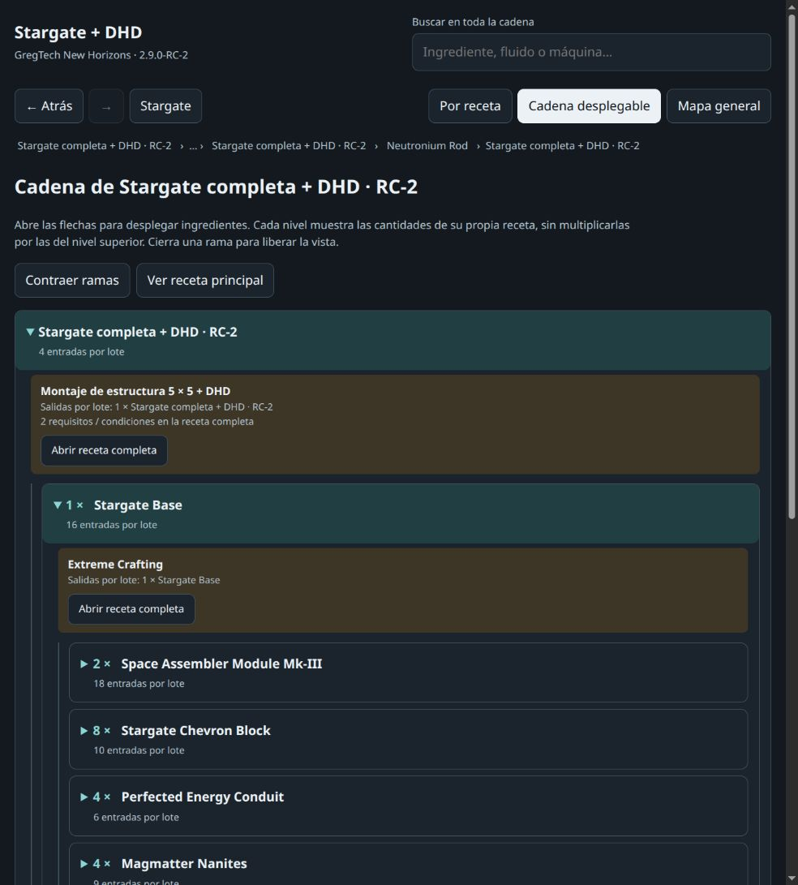

# Stargate — GregTech New Horizons 2.9.0-RC-2

Diagrama de fabricación en español para **1 Stargate Base + 8 Stargate Ring Blocks + 7 Stargate Chevron Blocks + 1 DHD**.

El recorrido seleccionado contiene **4.807 recursos y 4.076 procesos**. Incluye ingredientes, fluidos, coproductos, adquisiciones naturales, herramientas, catalizadores, investigaciones, condiciones y enlaces de fuentes. El mapa global contiene **8.883 nodos**.



## Abrir el diagrama

1. Descarga el [paquete completo de la versión 2.9.0-RC-2](https://github.com/luisfsandsilva-star/gtnh-stargate-flowchart/releases/download/gtnh-2.9.0-rc2-visor-v3/stargate-gtnh-2.9.0-rc2.zip).
2. Extrae todos los archivos en una misma carpeta.
3. Abre **`stargate-rc2-mapa.html`** en un navegador moderno. La vista **Por receta** muestra ingredientes → proceso → productos con texto legible. Pulsa un ingrediente para seguir su fabricación; usa Atrás, Adelante y el buscador para moverte.
4. **Cadena desplegable** permite abrir varias generaciones a la vez. Pulsa las flechas de cada ingrediente para explorar sus dependencias. Cierra una rama para liberar la vista. A partir de cinco niveles puedes usar **Continuar esta rama** como nueva raíz.
5. La pestaña **Mapa general** permite ampliar y desplazarse. Selecciona un nodo y pulsa **Abrir receta** para consultar sus detalles. Las listas largas tienen páginas de ocho elementos con su total visible.
6. Usa **`stargate-rc2-atlas.html`** para consultar alternativas del catálogo general. El recorrido anterior sigue disponible en **`stargate-rc2-recorrido.html`**.

Los visores funcionan sin conexión ni servidor. Mantén juntos los archivos para conservar los enlaces entre ellos. El atlas puede tardar unos segundos en cargar. GitHub muestra el código de los HTML; para usar los visores, descarga y abre los archivos localmente.

## Contenido

| Archivo | Uso |
| --- | --- |
| [Visor optimizado](entrega/stargate-rc2-mapa.html) | Recetas legibles, búsqueda global, historial y mapa Canvas bajo demanda |
| [Recorrido](entrega/stargate-rc2-recorrido.html) | Navegación recursiva por la ruta seleccionada |
| [Atlas](entrega/stargate-rc2-atlas.html) | Catálogo general de 276.088 registros, con alternativas |
| [SVG](entrega/stargate-rc2.svg) / [DOT](entrega/stargate-rc2.dot) | Mapa vectorial y grafo editable |
| [CSV](entrega/recetas-del-recorrido.csv) / [JSON](entrega/stargate-rc2-recorrido.json) | Datos del recorrido |
| [Desglose](entrega/desglose-stargate.txt) | Cantidades de los componentes principales de Stargate |
| [Fuentes](entrega/fuentes) | Manifiesto de versión, correcciones y evidencia |
| [Auditoría](entrega/auditoria-del-grafo.json) | Comprobaciones estructurales del grafo |
| [LEEME](entrega/LEEME.txt) | Alcance, interpretación de cantidades y límites de verificación |

## Visor v3: cadena desplegable y menos trabajo de dibujo

- Solo se crean las ramas que abres; al cerrarlas se eliminan sus elementos. Los ingredientes se paginan de ocho en ocho. La cadena completa sigue accesible al continuar desde cualquier recurso.
- Cada nivel muestra cantidades por lote de su propia receta, sin multiplicarlas por las del nivel superior. Las probabilidades se indican; el botón de receta completa conserva acceso a todos los coproductos, condiciones y metadatos.
- El panorama general reutiliza una imagen, y las etiquetas se calculan de nuevo solo al cambiar el zoom. El hit testing consulta celdas próximas, y la búsqueda mantiene solo los mejores candidatos por prioridad.
- Cambiar de vista conserva el zoom del mapa. Los procesos muestran también sus productos para distinguir recetas de la misma máquina.
- HTML autónomo de aproximadamente **0,70 MB**. Datos íntegros cotejados contra el JSON original: 4.807 recursos, 4.076 procesos y 17.755 slots.

Comprobado en el navegador integrado: expansión y cierre de ramas, paginación, búsqueda de nombre e ID, herramientas reutilizables, enlace a la receta superior, probabilidades, navegación entre vistas y 390 px sin desbordamiento horizontal. Una rama inicial abierta añade ocho nodos y vuelve a liberarlos al cerrarse. Véase [registro de comprobaciones](qa/visor-v3.json).

## Mediciones anteriores del visor v2

Estas mediciones corresponden al visor v2; no son un benchmark nuevo del v3.

Se conserva el contenido del recorrido: **4.807 recursos, 4.076 recetas y 17.755 entradas/salidas de receta**, incluyendo slots repetidos, NBT, alternativas, herramientas, probabilidades y condiciones. El cambio afecta a la presentación.

- Archivo del mapa: **10,95 MB → 0,69 MB**, aproximadamente un 94 % menos.
- La vista principal crea solo los elementos de la receta actual. Las listas largas están paginadas.
- El mapa general usa Canvas, consulta un índice espacial y dibuja a lo sumo una vez por fotograma. Sus conexiones se limitan a las del nodo seleccionado para evitar cruces ilegibles.
- Los datos se descomprimen fuera del hilo principal cuando el navegador admite Worker.

Mediciones de una apertura por viewport y muestras de interacción en el equipo de prueba, con Chrome headless sin limitación artificial de CPU:

| Medida, escritorio 1200 × 850 | Antes | Visor v2 |
| --- | ---: | ---: |
| Apertura hasta listo | 3.977 ms | 327 ms |
| Elementos DOM iniciales | 88.160 | 115 |
| Selección, promedio | 483 ms | 32 ms |
| Zoom, promedio | 305 ms | 33 ms |
| Arrastre, promedio | 325 ms | 47 ms |

En móvil de 390 px, la apertura medida fue de 310 ms. No se detectaron tareas largas durante las interacciones ensayadas; hubo una tarea larga inicial de aproximadamente 100 ms. Los resultados varían con el equipo y el navegador. El protocolo y las muestras están en [qa/rendimiento.json](qa/rendimiento.json).

Se comprobaron recetas de 31 salidas, cantidades simbólicas, slots repetidos, cuadrículas 9 × 9, NBT, desgaste de herramientas, 271 usos de un recurso con paginación, navegación, modo oscuro y anchos de 320 a 1.360 px.

## Editar y comprobar el visor

El código del visor está en [map-template.html](map-template.html). Para regenerarlo con los datos incluidos:

```sh
python3 build_fast_map.py
python3 qa/check-map-data.py
```

Para las comprobaciones de navegador, instala las dependencias de desarrollo con `npm install` y ejecuta `npm test`. Se usa Chrome en `/usr/bin/google-chrome`; puedes indicar otra ubicación con `CHROME_PATH`. Las pruebas generan capturas en `qa/` y no requieren conexión al juego ni a servicios externos.

## Alcance y verificación

Las cantidades son **por receta o lote**, no una suma total de materias primas. Las máquinas se representan como procesos y requisitos de infraestructura; la construcción de todas las máquinas, fábricas y redes energéticas queda fuera del desglose.

El recorrido seleccionado pasa las comprobaciones de referencias y ciclos: **0 referencias ausentes, 0 errores estructurales y 0 componentes cíclicos**, incluyendo dependencias reutilizables. Se comprobó la navegación de los visores en escritorio y móvil. Esto no sustituye una prueba completa en una instancia jugable ni certifica exhaustividad absoluta.

Algunas condiciones son probabilísticas o dependen de configuración, paralelismo, mejoras y NBT. El export público pierde parte de los metadatos; las limitaciones y correcciones están documentadas en el [LEEME](entrega/LEEME.txt). El atlas incluye recetas ajenas a Stargate y recursos sin adquisición verificada; sus cifras no describen únicamente la ruta seleccionada.

## Procedencia

- Versión fijada: **GTNH 2.9.0-RC-2**.
- Recetas principales: [NewHorizonsCoreMod 2.9.84 — ScriptSGCraft](https://github.com/GTNewHorizons/NewHorizonsCoreMod/blob/2.9.84/src/main/java/com/dreammaster/scripts/ScriptSGCraft.java).
- Corpus inicial: [dataset runtime RC2 de GTNH Planner](https://gtnhplanner.com/datasets/gtnh/local-2.9.0-rc-2/recipes.json.gz), con correcciones documentadas y cotejo de ramas críticas contra fuentes fijadas del pack.
- Cada proceso conserva su referencia de procedencia. El checksum anunciado por el manifiesto público del corpus no coincide con la descarga; esta limitación se documenta expresamente.

Las licencias originales de los datos y descripciones de terceros se mantienen. El repositorio no incluye binarios de los mods ni el volcado original de 1,9 GB.

SHA-256 del paquete de la release:

```text
aee04c961c7af6405f89102348c120afe19c685c4e96ab2a76612dc8709d8dcf
```
