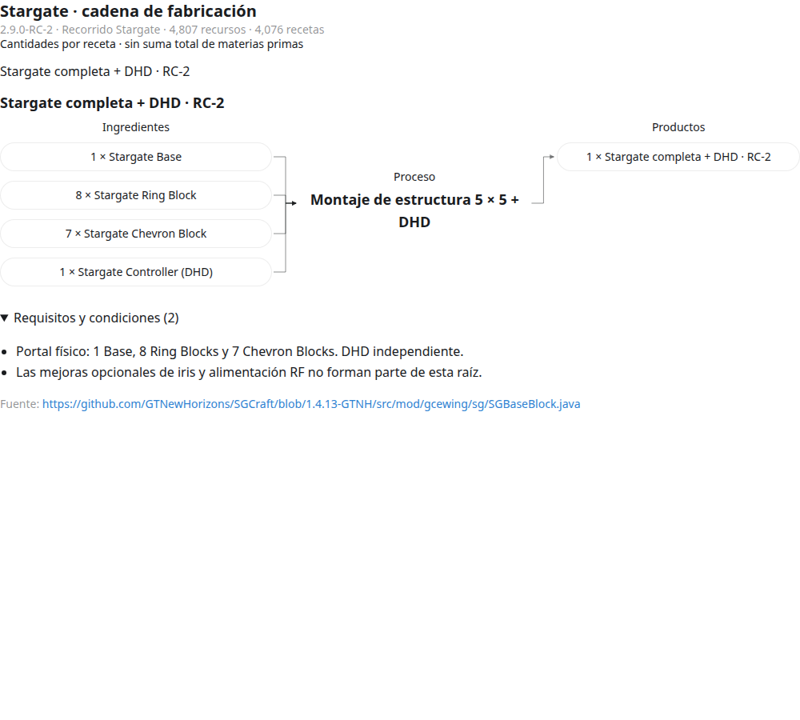

# Stargate — GregTech New Horizons 2.9.0-RC-2

Diagrama de fabricación en español para **1 Stargate Base + 8 Stargate Ring Blocks + 7 Stargate Chevron Blocks + 1 DHD**.

El recorrido seleccionado contiene **4.807 recursos y 4.076 procesos**. Incluye ingredientes, fluidos, coproductos, adquisiciones naturales, herramientas, catalizadores, investigaciones, condiciones y enlaces de fuentes. El mapa global contiene **8.883 nodos**.



## Abrir el diagrama

1. Descarga el [paquete completo de la versión 2.9.0-RC-2](https://github.com/luisfsandsilva-star/gtnh-stargate-flowchart/releases/download/gtnh-2.9.0-rc2/stargate-gtnh-2.9.0-rc2.zip).
2. Extrae todos los archivos en una misma carpeta.
3. Abre **`stargate-rc2-mapa.html`** en un navegador moderno: permite ampliar, desplazarse, buscar y consultar nodos.
4. Usa **`stargate-rc2-recorrido.html`** para recorrer ingredientes, y **`stargate-rc2-atlas.html`** para consultar alternativas.

Los visores funcionan sin conexión ni servidor. Mantén juntos los archivos para conservar los enlaces entre ellos. El atlas puede tardar unos segundos en cargar. GitHub muestra el código de los HTML; para usar los visores, descarga y abre los archivos localmente.

## Contenido

| Archivo | Uso |
| --- | --- |
| [Mapa global](entrega/stargate-rc2-mapa.html) | Zoom, desplazamiento, búsqueda y enlaces a recetas |
| [Recorrido](entrega/stargate-rc2-recorrido.html) | Navegación recursiva por la ruta seleccionada |
| [Atlas](entrega/stargate-rc2-atlas.html) | Catálogo general de 276.088 registros, con alternativas |
| [SVG](entrega/stargate-rc2.svg) / [DOT](entrega/stargate-rc2.dot) | Mapa vectorial y grafo editable |
| [CSV](entrega/recetas-del-recorrido.csv) / [JSON](entrega/stargate-rc2-recorrido.json) | Datos del recorrido |
| [Desglose](entrega/desglose-stargate.txt) | Cantidades de los componentes principales de Stargate |
| [Fuentes](entrega/fuentes) | Manifiesto de versión, correcciones y evidencia |
| [Auditoría](entrega/auditoria-del-grafo.json) | Comprobaciones estructurales del grafo |
| [LEEME](entrega/LEEME.txt) | Alcance, interpretación de cantidades y límites de verificación |

## Alcance y verificación

Las cantidades son **por receta o lote**, no una suma total de materias primas. Las máquinas se representan como procesos y requisitos de infraestructura; la construcción de todas las máquinas, fábricas y redes energéticas queda fuera del desglose.

El recorrido seleccionado pasa las comprobaciones de referencias y ciclos: **0 referencias ausentes, 0 errores estructurales y 0 componentes cíclicos**, incluyendo dependencias reutilizables. Se comprobó la navegación de los visores en escritorio y móvil. Esto no sustituye una prueba completa en una instancia jugable ni certifica exhaustividad absoluta.

Algunas condiciones son probabilísticas o dependen de configuración, paralelismo, mejoras y NBT. El export público pierde parte de los metadatos; las limitaciones y correcciones están documentadas en el [LEEME](entrega/LEEME.txt). El atlas incluye recetas ajenas a Stargate y recursos sin adquisición verificada; sus cifras no describen únicamente la ruta seleccionada.

## Procedencia

- Versión fijada: **GTNH 2.9.0-RC-2**.
- Recetas principales: [NewHorizonsCoreMod 2.9.84 — ScriptSGCraft](https://github.com/GTNewHorizons/NewHorizonsCoreMod/blob/2.9.84/src/main/java/com/dreammaster/scripts/ScriptSGCraft.java).
- Corpus inicial: [dataset runtime RC2 de GTNH Planner](https://gtnhplanner.com/datasets/gtnh/local-2.9.0-rc-2/recipes.json.gz), con correcciones documentadas y cotejo de ramas críticas contra fuentes fijadas del pack.
- Cada proceso conserva su referencia de procedencia. El checksum anunciado por el manifiesto público del corpus no coincide con la descarga; esta limitación se documenta expresamente.

Las licencias originales de los datos y descripciones de terceros se mantienen. El repositorio no incluye binarios de los mods ni el volcado original de 1,9 GB.

SHA-256 del paquete de la release:

```text
d377fc784bcf629d7852c6a2a3e0a04cf7a78a5a3982eceeaae115322af2f9ae
```
